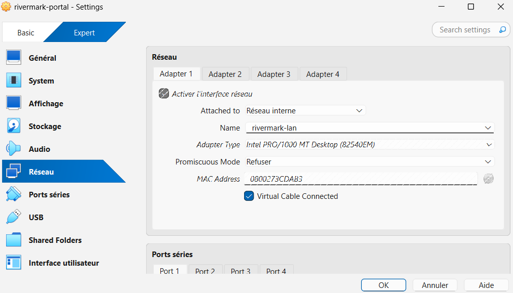
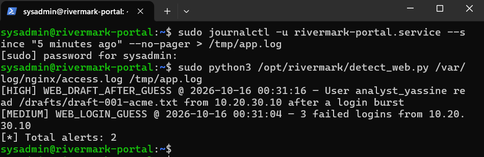
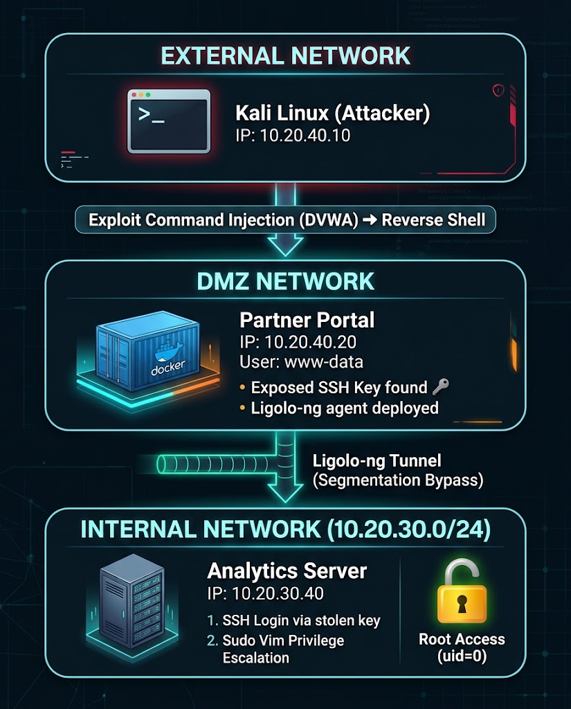

# Rivermark Security Lab — Blue Team & Red Team, End to End

**Author:** Fadi Bellalah · [GitHub](https://github.com/fadi1008)

Rivermark Partners is a **fictional** boutique investment research firm. Its crown jewel is not the web server but its **unpublished research drafts**.
This lab builds the company's security from scratch, defends it (Phase 1), then attacks it from the outside like a penetration tester (Phase 2).

| Phase | Role | Status | Main deliverable |
|---|---|---|---|
| 1 | Blue Team — SOC, detection, incident response | ✅ Completed | [Incident reports](incidents/) · [Detection rules](detections/) |
| 2 | Red Team — external → internal penetration test | ✅ Completed | [Penetration test report](phase2/report/README.md) |

> **Ethics:** everything runs in an isolated VirtualBox lab. All IPs are RFC 1918, all data is synthetic, and sensitive artefacts (keys, tokens) are redacted. See [sanitization process](docs/sanitization.md).

---

## Phase 1 — Blue Team: SOC & Detection

### Architecture & hardening
- **Lab network:** isolated VirtualBox internal network (`10.20.30.0/24`); management plane on Host-Only (`192.168.56.0/24`).
- **Portal server:** Ubuntu 24.04 (Nginx, custom Python app, SSH).
- **Controls:** UFW default-deny, TLS (HTTPS), SSH key-only authentication, least privilege (app bound to `127.0.0.1`, source owned by `root`).
- Details: [architecture](docs/architecture.md) · [hardening](docs/hardening.md) · [design decisions](docs/decisions.md)



### Simulated incidents
- **INC-001 — SSH brute force** (Hydra against a developer account). Shell obtained, but file permissions (`750`) protected the drafts. → [report](incidents/INC-001-ssh-guessing.md)
- **INC-002 — Web brute force** (analyst password guessed on the portal). A confidential draft was accessed. → [report](incidents/INC-002-web-draft.md)
- **Response:** identity-based containment (password rotation) instead of blocking the shared IP `10.20.30.10`, which would have caused a business outage. → [response playbook](incidents/response.md)

### Detection engineering
Custom Python detections parse raw logs and raise alerts:

| Alert | Logic |
|---|---|
| `SSH_GUESS` | Many pre-auth disconnects from one IP |
| `SSH_SUCCESS_AFTER_FAILURES` | Successful login after a burst of failures |
| `WEB_LOGIN_GUESS` | Repeated `POST /login` attempts |
| `WEB_DRAFT_AFTER_GUESS` | Joins Nginx and app logs to show who read a draft after a guessing burst |

Runs every 5 minutes through a **systemd timer** with a cursor bookmark, so past incidents do not re-alert. Rules: [SSH](detections/ssh-auth.md) · [Web](detections/web-auth.md)



---

## Phase 2 — Red Team: External-to-Internal Penetration Test

**Scope:** DMZ (`10.20.40.0/24`) → dual-homed Partner Portal → internal Analytics server (`10.20.30.0/24`).
**Result:** full `root` on the internal Analytics server and access to the confidential drafts, starting from the internet-facing portal with no credentials.



| ID | Finding | Severity |
|---|---|---|
| [F-01](phase2/report/findings/F-01-command-injection.md) | Command injection in the public web app | Critical (9.8) |
| [F-02](phase2/report/findings/F-02-exposed-ssh-key.md) | SSH private key exposed on the DMZ host | Critical (9.8) |
| [F-03](phase2/report/findings/F-03-segmentation-failure.md) | Network segmentation failure (dual-homed host) | High (8.8) |
| [F-04](phase2/report/findings/F-04-sudo-vim.md) | Privilege escalation via `sudo vim` | High (8.8) |

**Report:** [executive summary](phase2/report/00-executive-summary.md) · [scope & RoE](phase2/report/01-scope-roe.md) · [methodology](phase2/report/02-methodology.md) · [attack narrative](phase2/report/03-attack-narrative.md) · [MITRE ATT&CK mapping](phase2/report/08-attack-mapping.md) · [detection gaps](phase2/report/06-detection-gaps.md) · [remediation](phase2/report/09-remediation.md) · [retest plan](phase2/report/10-retest-plan.md)

**Blue ↔ Red link:** the [detection gaps](phase2/report/06-detection-gaps.md) section maps which Phase 2 steps the Phase 1 detections would and would not have caught.

---

## Repository structure
```
docs/            architecture, hardening, decisions, sanitization, case study
detections/      detection rule documentation
incidents/       Phase 1 incident reports and response playbook
evidence/        sanitized Phase 1 log excerpts and baselines
phase2/report/   Phase 2 penetration test report, findings, redacted evidence
phase2-red-team/ mission-by-mission working notes
images/          screenshots and diagrams
```

## Skills demonstrated
`Linux administration` · `Network segmentation` · `Nginx / TLS` · `UFW` · `SSH hardening` · `Python` · `Log analysis` · `Detection engineering` · `Incident response` · `Web exploitation` · `Pivoting / tunneling` · `Linux privilege escalation` · `CVSS scoring` · `MITRE ATT&CK` · `Pentest reporting`
