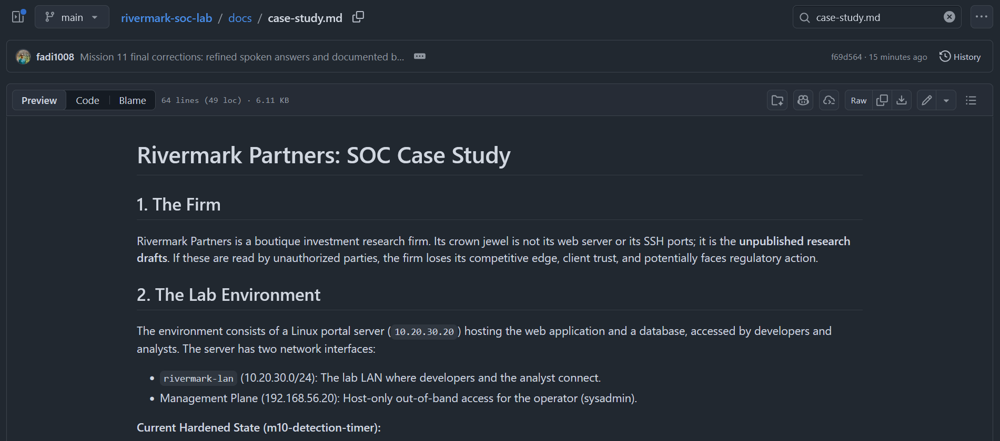

# Rivermark SOC Lab: End-to-End Security Operations

## Project Overview
Rivermark Partners is a fictional boutique investment research firm. Their crown jewel is not their web server; it is their **unpublished research drafts**. This project simulates a junior security analyst building a Security Operations capability from scratch for this small business.

This lab covers the full lifecycle: **Architecture, Attack Simulation, Detection Engineering, Incident Response, Hardening, and Automation.**

## 🏗️ Architecture & Hardening
- **Lab Network:** Isolated VirtualBox Internal Network (`10.20.30.0/24`). Management plane on Host-Only (`192.168.56.0/24`).
- **Portal Server:** Ubuntu 24.04 (Nginx, custom Python App, SSH).
- **Security Controls:** UFW (default deny), TLS encryption (HTTPS), SSH Key-only authentication, Principle of Least Privilege (App runs on `127.0.0.1`).

## 🚨 The Incidents
I simulated two controlled attacks against the lab and wrote full incident reports.
- **INC-001 (SSH Brute Force):** An attacker used Hydra to guess a developer's password. 
  - *Impact:* Shell obtained, but file permissions (750) prevented access to the drafts.
- **INC-002 (Web Brute Force):** An attacker guessed an analyst's password on the web portal.
  - *Impact:* A confidential draft was successfully accessed. 
- **Response:** Identity-based containment (rotating passwords) without blocking the shared IP (`10.20.30.10`), which would have caused a business outage.

## 🛡️ Detection Engineering
I wrote custom Python detection scripts (`scripts/`) that parse raw logs and fire alerts for:
1. `SSH_GUESS` (Multiple preauth disconnects from one IP).
2. `SSH_SUCCESS_AFTER_FAILURES` (Login success after a burst of failures).
3. `WEB_LOGIN_GUESS` (Multiple 200 OKs on POST /login).
4. `WEB_DRAFT_AFTER_GUESS` (Joining Nginx logs with App logs to see who read a draft).

The detection script is automated via a **systemd timer** that uses a cursor bookmark to ensure old incidents do not re-alert.

### Example Alert (INC-002 Web Attack)

## 📂 Key Artifacts
- [Case Study & Spoken Answers](docs/case-study.md)
- [Incident 001 Report](incidents/INC-001-ssh-guessing.md)
- [Incident 002 Report](incidents/INC-002-web-draft.md)
- [Detection Rules](detections/)
- [Sanitization Process](docs/sanitization.md)

## 🧠 Skills Demonstrated
`Linux Administration` • `Network Segmentation` • `Nginx` • `Python` • `TLS/HTTPS` • `UFW` • `SSH Hardening` • `Log Analysis` • `Incident Response` • `MITRE ATT&CK` • `Systemd Automation`